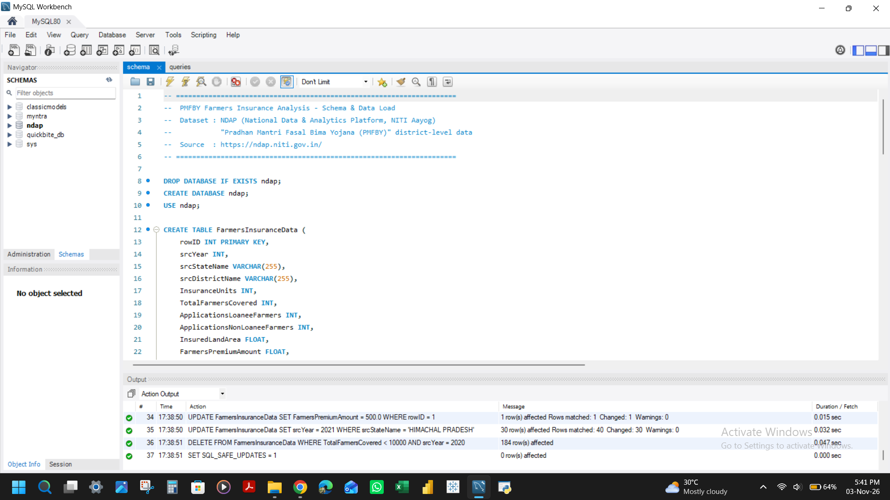
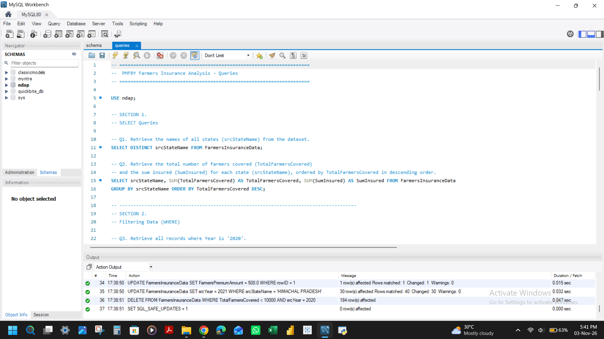

# PMFBY Farmers Insurance Analysis (SQL)

## 📌 Project Overview

The **PMFBY Farmers Insurance Analysis** is a MySQL project that explores district-level data from India's **Pradhan Mantri Fasal Bima Yojana (PMFBY)** crop insurance scheme, using open government data from NDAP (National Data & Analytics Platform, NITI Aayog).

The project follows an end-to-end workflow:

**Raw NDAP Data → Schema Design & NULL-Safe Loading (MySQL) → Analytical SQL Queries → Insights**

## 🌾 Industry

**Agriculture — Crop Insurance (Public Policy)**

## 💡 Business Problem

Crop insurance only works if it reaches the right farmers. Policymakers and analysts need to see where PMFBY coverage is deep or thin, how premium is shared between farmers, states and the government, and whether coverage keeps pace with population. District-level government data is large and messy, with missing values and inconsistent formats, so it needs careful loading and structured querying before it can answer those questions.

## 🎯 Objective

Explore farmer coverage, premium collection, and demographic and population patterns across states and districts by evaluating:

* Total farmers covered and insurance units by state and district
* Premium amounts (farmer, state and government share) and sum insured
* Coverage by gender, social category and farm size
* Coverage ratio (farmers covered relative to total population)

The project also practises the full range of core-to-intermediate SQL skills on a real government dataset.

## ✨ Key Features

* Complete MySQL schema with a 44-column table for district-year records
* NULL-safe `LOAD DATA` that stores blank or non-numeric values as `NULL` instead of `0`
* 26 analytical queries, organized by topic
* Top-N rankings of states and districts
* Coverage-ratio analysis relative to population
* Self-joins, subqueries and constraint examples on one table
* Walkthrough video and screenshots of the schema and queries

## 📊 Dataset

* **Source:** [NDAP - National Data & Analytics Platform](https://ndap.niti.gov.in/)
* **Table:** `FarmersInsuranceData`
* **Size:** 1,870 rows × 44 columns

Each record is a district-year observation covering:

* Insurance units and total farmers covered
* Loanee and non-loanee applications
* Insured land area, premium amounts (farmer / state / government) and sum insured
* Percentage of farmers covered by gender (male, female, others), category (SC, ST, OBC, General) and farm size (marginal, small, other)
* Population, household and land-area statistics (total, urban, rural)

## 🧹 Data Loading & Validation

The raw CSV contains blank and non-numeric values in several numeric columns. A plain `LOAD DATA` converts these to `0`, which would pull averages down, or skips rows entirely.

* The percentage and land area columns are loaded through user variables and checked with a `REGEXP` pattern.
* Any value that is not a valid number is stored as **`NULL`**, so `AVG()` and similar functions ignore it.
* **Result:** all 1,870 rows load with 0 warnings.

## 🧠 SQL Concepts Demonstrated

* Basic `SELECT` / `DISTINCT`
* Filtering with `WHERE`, multiple conditions and ranges
* `GROUP BY` aggregation (`SUM`, `AVG`)
* `ORDER BY` + `LIMIT` for top-N analysis
* String functions (`LEFT`, `LIKE`) for pattern matching
* `INNER JOIN` and `LEFT JOIN` (self-joins on the same table)
* Correlated and non-correlated subqueries
* Table constraints and `FOREIGN KEY` relationships
* `UPDATE` and `DELETE` with conditions
* Data cleaning during load (`REGEXP`, `TRIM`, `IF`)

## 📈 Sample Insights

* States can be ranked by total farmers covered and total sum insured to see where PMFBY has the deepest reach.
* Coverage ratio (farmers covered / total population) highlights districts where insurance penetration is highest relative to population, not just in absolute terms.
* Districts with premium collections above ₹20 crore stand out as the highest-value insurance markets in the dataset.

## 🛠️ Technology / Tools

* **MySQL / MySQL Workbench** — schema design, data loading and analysis
* **Git & GitHub** — version control and project showcase

## 🔄 Project Workflow

```text
NDAP Dataset (CSV)
      ↓
Schema Design (MySQL)
      ↓
NULL-Safe Data Load (LOAD DATA LOCAL INFILE)
      ↓
Analytical Queries (26 queries)
      ↓
Insights
      ↓
GitHub Repository
      ↓
LinkedIn Showcase
```

## 📁 Project Structure

```text
PMFBY-Farmers-Insurance-SQL-Analysis/
│
├── data.csv
├── schema.sql
├── queries.sql
├── schema.png
├── queries.png
├── Video.mp4
└── README.md
```

| File | Contents |
|---|---|
| `data.csv` | PMFBY district-level dataset from NDAP (1,870 rows) |
| `schema.sql` | Database and table definition, plus NULL-safe `LOAD DATA` statement |
| `queries.sql` | 26 analytical queries, organized by topic |
| `schema.png` | Screenshot of the schema and data load |
| `queries.png` | Screenshot of query output |
| `Video.mp4` | Walkthrough of the project |

## 🖼️ Screenshots

**Schema and data load**



**Queries**



## ▶️ How to Run

1. Clone or download this repository. `data.csv` is already included.
2. In MySQL Workbench, enable local file loading on your connection: **Edit Connection → Advanced → Others**, then add `OPT_LOCAL_INFILE=1` and reconnect.
3. Open `schema.sql` and change the path in `LOAD DATA LOCAL INFILE` to where `data.csv` is on your machine, for example `'D:/Projects/PMFBY-Farmers-Insurance-SQL-Analysis/data.csv'`.
4. Run `schema.sql`. It recreates the `ndap` database, builds the table and loads the data. The final check should return **1870** rows.
5. Run `queries.sql` to execute the analysis queries.

> **Note:** `schema.sql` starts with `DROP DATABASE IF EXISTS ndap;`, so it replaces any existing database with that name.

## 🎯 Business Value

This kind of analysis can help policy and insurance teams:

* Identify states and districts with the deepest and thinnest PMFBY reach
* Compare coverage across gender, social category and farm size
* Spot high-value insurance markets by premium collected
* Judge penetration relative to population, not just absolute numbers

## 🚀 Future Enhancements

* Add a Tableau or Power BI dashboard on top of the cleaned table
* Add year-over-year trend queries and window functions (`RANK`, `LAG`)
* Build views for the most-used state and district summaries
* Add indexes and compare query performance
* Combine with other NDAP datasets such as rainfall or crop yield

## 📌 Project Deliverables

* MySQL schema and NULL-safe data load script
* 26 analytical SQL queries
* Cleaned dataset load (1,870 rows, 0 warnings)
* Schema and query screenshots
* Walkthrough video
* GitHub repository documentation
